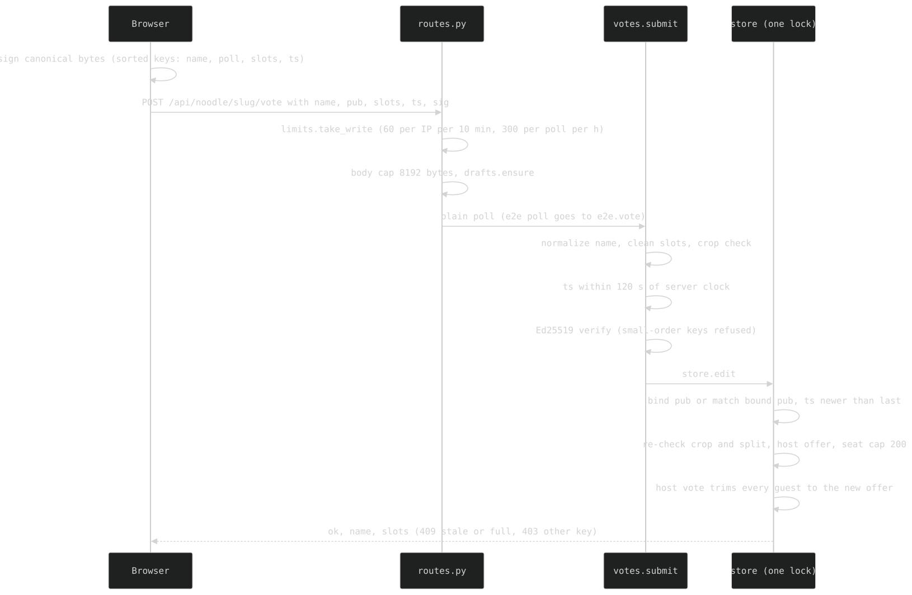
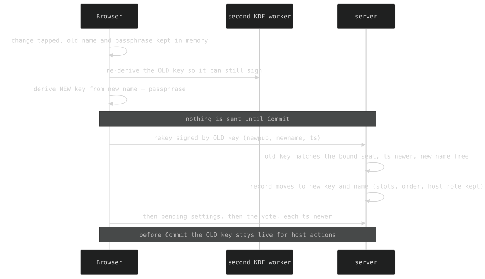
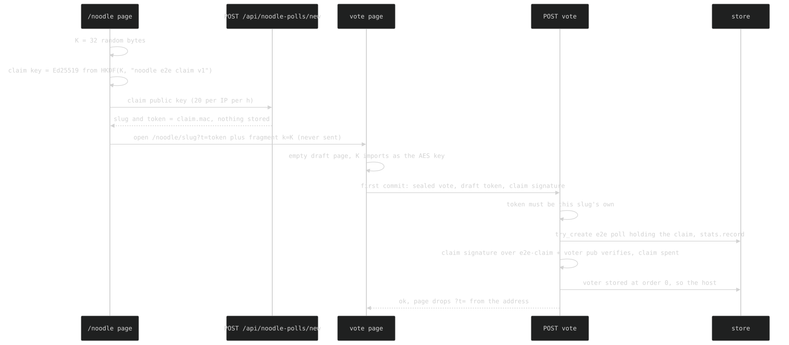
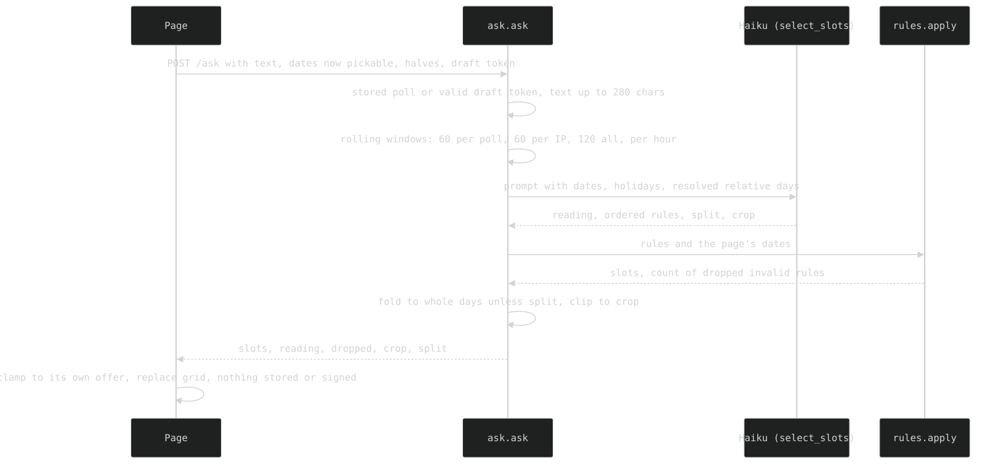

# noodle — ARCHITECTURE

Own repo (`wai-lau/noodle`), consumed by exec-fn as the submodule `apps/noodle`.
A bare `§N` below (other than §21's own subsections) means a section of
**exec-fn's** ARCHITECTURE.md; how the parent serves this app is exec-fn §1e.
History, incidents and superseded designs: **ARCHAEOLOGY.md** (same numbering).

## 21. noodle — an isolated scheduling poll

A Doodle-style poll at `/noodle/<slug>`: slots are `(date, midday|night)`, or on
an unsplit poll `(date, whole day)` — no clock times. **Fully standalone**:
`api/noodle/` imports stdlib, fastapi, `anthropic` and `cryptography` only,
never another app module (pinned by `tests/test_noodle_isolation.py`). Own state
directory, own HTML shell (no Exec bubble, no voice, **no CRT stack**; the site
nav only on `/noodle`, handed in by exec-fn's `routers.py` via
`pages.set_nav` / `set_owner`); it links `/chrome.css` for palette + scale
tokens only. Three bare routers carry it — `routers.py` mounts `routes.router`
on `public`, `guest_router` on the guest tier, `owner_router` on `protected`;
noodle itself holds no auth. The browser derives an Ed25519 key from the
passphrase (`noodle-kdf-worker.js`) and never sends the passphrase or private key. A plain-poll vote carries `{name, pub, slots, ts, sig}`; an end-to-end one (every poll since 2026-10-09, 21m) carries `{pub, ct, ts, sig}` (+ `claim`/`draft` on a first vote), the name and slots sealed inside `ct`.

### File map

**Server** (`api/noodle/`):

| File | What |
|---|---|
| `routes.py` | `router` (public: poll page/JSON, vote/settings/remove/rekey/ask), `guest_router` (`/noodle` + `POST /api/noodle-polls/new`), `owner_router` (list/create/delete + per-day counts). |
| `pages.py` | HTML shell, Open Graph, KDF config as `data-*`, `set_nav`/`set_owner` injection points, `public_poll()`. |
| `store.py` | One sealed JSON file per poll under `DATA_DIR/polls/`; the one lock; atomic writes; `RULES` stamp. |
| `drafts.py` | A poll that doesn't exist yet: `<claim>.<mac>` token, `new_for` (rate limit), `ensure()`. |
| `stats.py` | Polls created per day, `DATA_DIR/created.json` = `{"YYYY-MM-DD": n}` (21i). |
| `votes.py` | `VoteError`, `now_ms`, `check_action` (shared signed-action envelope), `host_of`, `_admit`, `submit`, `reset_voter`. |
| `host.py` | Host-only plain actions: `settings` (split/crop/title/note), `remove`. |
| `rekey.py` | Plain passphrase/name change: old key signs the new one. |
| `e2e.py` | END-TO-END polls (21m): sealed vote/head/remove/rekey + `public()`. |
| `sig.py` | Ed25519 `verify`, `valid_pub` (small-order refusal), `canonical()` / `canonical_action()`. |
| `slots.py` | `normalize_name`, `codes`, `parse_window`, `clean_slots`, `convert`. |
| `limits.py` | Rolling-window write limiter (vote/settings/remove/rekey). |
| `rules.py` | Ask noodle's rule language + `apply()`. |
| `ask.py` | Ask rate limits, prompt assembly, `ask()`. |
| `llm.py` | Haiku client + `SLOT_TOOL` schema. |
| `holidays.py` | Quebec holidays — Python mirror of exec-fn's `web/qc-holidays.js`. |
| `config.py` | Every knob (KDF params, caps, rate limits). |
| `reset.py` | Owner CLI: `python -m noodle.reset <slug> "<name>"` (plain polls only). |

**CSS** (`web/`), in this order in `noodle-shell.html` — **load order is the
cascade**: `chrome.css` (exec-fn) → `noodle.css` → `noodle-identity.css` →
`noodle-actions.css` → `noodle-roster.css` → `noodle-split.css` →
`noodle-admin.css` → `noodle-created.css` → `noodle-foot.css` → `noodle-cal.css`.

**JS** (`web/`), in this order in `noodle-vote.html` — **order matters**:
`noodle-vote.js` runs `ndvInit()` as it loads, so everything it calls is
loaded first: `qc-holidays` → `noodle-toggle` → `noodle-seal` → `noodle-cal` →
`noodle-cal-view` → `noodle-kdf` (+ `noodle-kdf-worker`) → `noodle-esc` →
`noodle-roster` → `noodle-crop` → `noodle-keystore` → `noodle-storage` →
`noodle-identity` → `noodle-claim` → `noodle-e2e` → `noodle-commit` →
`noodle-vote` → `noodle-ask` → `noodle-host` → `noodle-rekey` → `noodle-top` →
`noodle-share`. `/noodle` (`noodle-admin.html`) loads `noodle-claim`,
`noodle-admin`, `noodle-created`. `noodle-identity.js` loads BEFORE `NDV`
exists, so nothing in it may run at load.

**Templates** (`api/templates/`): `noodle-shell.html` (shared shell, `.page-scroll`
wrapper, OG slot), `noodle-vote.html` (poll body + scripts), `noodle-admin.html`
(`/noodle` body + its 3 scripts).

**Front ends** (`pages.SKINS`, 2026-10-23): ONE backend, one set of polls, two
looks. `/noodle` + `/noodle/<slug>` is the original; `/noodle-tc` +
`/noodle-tc/<slug>` (same tier each) is the Tarid Change look -- the SAME
templates and JS, plus `noodle-tc.css` loaded LAST, `noodle-tc-copy.js` in
the `<head>` and `noodle-tc-legend.js` (deferred). The shell carries `data-base` (`/noodle` or `/noodle-tc`) and
`{{THEME}}`; the JS builds every page link from `data-base` (`noodle-admin.js`
post-create redirect, `noodle-e2e.js` `ndeLink`, `noodle-share.js`), so a poll
made or shared on a front end stays on it -- and any link opens on either.
- **The look** re-points the shared palette tokens on `body.noodle-tc`
  (`--green/--gray/--cyan/--orange-hsl` -> one deep-green ink, `--bg-hsl` ->
  peach, `--font-mono` -> Almarai, `--radius-2` -> 10px), then sets type,
  buttons and the ground: taridchange.com's colours, MUTED (owner: its own
  were too saturated). Built to "UX accessibility for elderly -- 12
  principles" (Trzepla 2019), each rule tagged [P1]..[P12] in the sheet: 18px
  type, line height 1.5, MEASURED contrast (ink >= 4.9:1 on every ground
  stop; cream only on the rust, 7.4:1), pressable bordered buttons, "Step 1
  of 2" markers, months in full, no decorative motion. Step 2 is HIDDEN
  during step 1, not greyed -- but kept laid out (invisible, out of flow),
  never `display:none`: the crop frame measures the rows then, and with no
  layout both edges landed on one line.
- **The ground and the browser bars**: NO theme-color (a solid one drew a hard
  band). The gradient is a FIXED layer `100lvh` tall (under the toolbars
  too), and html's colour is the ground's foot as it shows under the grain
  (measured): iOS Safari paints that colour flat under its floating toolbar
  and past the page's ends, so the two meet. Edge strips for the bars to
  sample did nothing on iOS 26 but draw a line.
- **The calendar**: picked days are PEACH (not ink-filled), offered days a
  soft peach wash, so one set of pips reads on every cell. Pips: N voters share the
  hue circle EQUALLY (a triangle for 3, a square for 4) from a host hue seeded
  by the slug, one dark earthy tone, no outline; past 6 voters they also take
  a shape (circle / square / triangle), carried IN the ink string as
  `--tc-pip-r` / `--tc-pip-clip` (`noodle-tc-legend.js` wraps `NoodleSeal.seal`); a number badge was tried and was too small. NOT
  `:has()` on the pips' pseudo-elements: WebKit does not re-check it when
  the dots are injected later. The host's crop is a photo editor's frame
  (corners + edge ticks), the outside dimmed with its hue kept, its grab
  strip 44px and almost all OUTSIDE the crop so it never steals a tap. Inside
  the grid the type is noodle's own size: its cells are sized for it, and
  the skin's 18px pushed the pips out of the cell.
- **No roster row**: the name cards and the host's guide are hidden (owner);
  with them go tap-a-name-to-fill-it and the host's Remove-guest button.
  The names live in the PIP LEGEND under the calendar (`noodle-tc-legend.js`):
  it reads the hidden roster the shared JS still renders (`.nd-face`
  data-name + the ink on its `.nd-seal`), redraws on every change, builds
  names with `textContent`, and the wording layer skips it (a voter named
  "noodle" stays "noodle").
- Fonts are self-hosted (`fonts/tc-*.woff2`, SIL OFL): the vote CSP allows
  `font-src 'self'` only.
- **The wording** is a DOM layer, not a fork: `noodle-tc-copy.js` rewrites
  every text node / `placeholder` / `title` / `aria-label` whose whole text is
  a key in its table (or matches a pattern: messages with a name or number in
  them), plus the native `confirm()`. A MutationObserver runs before paint, so
  the original words never show. It NEVER touches poll content (`#nd-title`,
  `#nd-note`, names) -- `noodle-host.js` reads the title back to spot the
  `title` placeholder, which `noodle-tc.css` shows as "Add a title" instead.
  **A new or changed string in the shared JS shows in noodle's own words on
  /noodle-tc until its line is added to that table**; server error text
  (`votes.py` etc.) is not translated.
- **Security wiring outside this repo**: both slug masks cover `/noodle-tc/`
  (exec-fn `api/log_masking.py`, nginx `conf.d/noodle-log-mask.conf`), and the
  guest page set lists it (exec-fn `_GUEST_NEXT_ALLOWED`, the 401 handler).
  Any further front end needs all four.

**Tests** (`tests/test_noodle_*.py`): unit — isolation, crypt (at rest), votes,
host, rekey, drafts, ask, rules, holidays, names, convert, toggle, glyphs,
limits, stats, legacy, hardening, e2e, e2e_view. Browser (WebKit/Playwright) —
`test_noodle_browser.py` (sign/vote), `_page`, `_host`, `_keys`, `_created`,
`_e2e`, `_signed`, `_csp`, `_journey`; helpers in `tests/noodle_helpers.py`.
exec-fn's side: the `noodle_slug` fixture (root `conftest.py`, a fresh poll per
session), smoke rows in `tests/test_smoke.py`.

### 21a. Access tiers & routes

| Route | Tier | What |
|---|---|---|
| `GET /noodle/{slug}` (`?t=` draft) | public | vote page; a draft token for an unstored slug renders an empty e2e poll |
| `GET /noodle/{slug}/results` | public | 301 to the vote page (no separate results page) |
| `GET /api/noodle/{slug}` | public | poll JSON (`e2e.public` or `pages.public_poll`), `no-store` |
| `POST /api/noodle/{slug}/vote` · `/settings` · `/remove` · `/rekey` | public | signed writes; dispatched by the STORED poll's `e2e` flag |
| `POST /api/noodle/{slug}/ask` | public | Ask noodle (21h) |
| `GET /noodle` | guest | start page; `frame-ancestors 'none'` CSP, `no-store` |
| `POST /api/noodle-polls/new` | guest | mint a draft (21c) |
| `GET/POST /api/noodle-polls`, `DELETE /api/noodle-polls/{ref}` | owner | list (file ids + mtimes only) / titled create (plain poll) / delete by slug or file id |
| `GET /api/noodle-polls/created` | owner | per-day creation counts (21i) |

Tier enforcement lives entirely outside the package (exec-fn's
`tests/test_admin_only.py` enumerates `owner_router`). Holding the link is the
only access control for **voting**: the slug is `secrets.token_urlsafe(16)` (22
chars, `[A-Za-z0-9_-]`), checked against that exact shape (`store._SLUG_RE`)
before it becomes a path component. The owner's `/noodle` page uses the same
`/new` a guest would; the titled owner endpoint is direct-API only.

Every body is capped on declared `Content-Length` AND actual bytes read:
`BODY_MAX_CREATE` 1024, `BODY_MAX_VOTE` 8192, `BODY_MAX_ASK` 1024. Vote pages
send `X-Robots-Tag: noindex`, `Referrer-Policy: no-referrer`, `no-store`, so a
slug never leaks via Referer. CSP: see 21m.

### 21b. Identity: passphrase -> key -> seal

`noodle-kdf.js` debounces `KDF_DEBOUNCE_MS` (1000ms) after typing stops, then a
Worker runs Argon2id (hash-wasm 4.12.0, vendored under `web/vendor/`, MIT) to a
32-byte seed, wrapped in the fixed RFC 8410 PKCS#8 prefix (WebCrypto has no
raw-seed import) and imported as Ed25519. The signing key is **non-extractable**;
an extractable copy exists only long enough to read the public half. Salt =
`SHA-256(slug + NUL + normalized name)[:16]` — same name+passphrase gives the
same key on any device, a different key per poll (e2e polls also fold the poll
key in, 21m). Only one derive runs: a change mid-derive **terminates the worker**
and a generation counter drops stale results. KDF params (`config.KDF_*`:
m=65536 KiB, t=2, p=1, len=32) reach the page as `data-kdf`, so page and config
can't disagree; retune `KDF_T` after measuring on a phone.

**Name normalization must match byte for byte** between `slots.normalize_name`
and `noodleNormName` (`noodle-kdf.js`): NFKC, reject `Cc`/`Cf`, collapse
whitespace, lowercase, then ASCII letters/digits/spaces only (the page strips
anything else as typed), max `NAME_MAX` 40. Stored and shown normalized.
Pinned by `tests/test_noodle_names.py`.

**The seal** (`noodle-seal.js`, one implementation for a voter's own seal and
every roster seal): border cells, eyes, mouth and HSL ink are picked
deterministically from `SHA-256(raw pubkey)` byte by byte (border: 256/32, eyes
16, mouth 8 divide 256 evenly; the ink's hue/saturation/lightness use a plain
modulo of their bytes, a negligible bias). Ink lightness is floored (62-82%) so it reads on black; it reaches CSS as the
page-local `--seal-hsl` token (`scripts/lint-colors.py` `LOCAL_ACCENTS` in
exec-fn) and colours that voter's calendar dots.

**One section edits at a time** (`ndvStep`/`ndvPaintStep`, `noodle-identity.js`):
`NDV.step` is `'you'|'pick'`. YOU = name + passphrase + seal; PICK = calendar,
Ask, Commit. The host's title/note are editable on either step and sent only
with Commit. On YOU the pick is a grey read-only preview; `#nd-next` (or Enter)
advances once a name is typed, with the reason it is grey shown above
(`ndvNextWhy`). A saved identity that unlocks skips to PICK (`NDV.autoStep`);
a name sealed by another key falls back to YOU; tapping a roster face returns to
YOU. Rekey: `change` is on YOU, Commit (on PICK) carries it. The Ask box's text
is under iOS's 16px focus-zoom line, so the shell viewport carries
`maximum-scale=1` (Android does not pinch-zoom on noodle pages — accepted).

**A name sealed by another key locks the page** (`ndvSyncLock`): calendar, Ask
and Commit go grey + `inert` (`.nd-locked`), the caption reads
`NOT <name>'s seal of approval`; only identity fields and voter faces stay live.

History (UI audit, normalization): ARCHAEOLOGY.md 21b.

### 21c. Votes, the host, rekey, drafts

**Votes.** `votes.submit()` runs every stateless check (name/ts shape,
`TS_SKEW_MS`=120s window, Ed25519 over `sig.canonical(poll,name,slots,ts)`)
before the store lock; only binding + replay need the file. Signed bytes:
`json.dumps({name,poll,slots,ts}, sort_keys=True, separators=(",",":"),
ensure_ascii=False)`, encoded UTF-8 `surrogatepass`; `ndvSubmit` reproduces it by
inserting keys in sorted order before `JSON.stringify`. `ts` must be inside the
skew window AND strictly newer than the last accepted one for that key. The page
reads the server's clock off the `Date` header (`NDV.skew`). The first submission
for `(poll, name)` binds a pubkey; later ones must verify under it (an empty
stored `pub` means the owner reset it). `votes.host_of()`: vote order 0 is host,
their picked slots ARE the offer — enforced in `_admit` and client-side
(`setAllowed`); `_trim_guests` trims every guest to a new host offer in the same
write. Orders are `max+1`, never `len()`.

**Recovery** is owner-only and forgets the key, not the vote:
`docker compose exec -w /app/apps/noodle/api api python -m noodle.reset <slug> "<name>"`
blanks `pub`/`ts`; slots and column `order` are kept; the next signed submission
re-binds whatever key signs it. Plain polls only (21m).

**The host & host actions.** Whoever acts FIRST on a fresh plain poll — a vote,
or `host.settings` — is host (order 0). Every plain host action shares
`votes.check_action()`: name+ts shape, skew window, and `sig.canonical_action()`,
whose mandatory `kind` field stops a vote replaying as an action or vice versa.
`host.settings()` sets split/crop/title/note in one signed request (title/note
ride only when changed). Flipping `halves` re-expresses every voter via
`slots.convert()`; narrowing the crop drops out-of-crop slots from everyone.
`host.remove()` deletes a guest's record; a host never removes themself. The
client mirrors the envelope (`ndhSend`/`ndhCanon`): sorted-key signature, `kind`
stripped before sending (the server supplies it).

**Rekey.** A name is bound to the key its first vote signed with (name AND
passphrase together), so changing either is a re-bind only the CURRENT key may
make.

Plain: `rekey.rekey` checks `canonical_action(kind="rekey", name, newname,
newpub, poll, ts)` against the bound record, requires strictly newer `ts`,
409s a taken `newname`, and moves the record (slots, order, host role). Client
(`NDR`, `noodle-rekey.js`): `change` keeps the old name+passphrase in memory,
spawns a **second** KDF worker (`NDR.keeper`) to re-derive the old key, and
becomes `undo`; **Commit carries the change** (`ndrCommit(ts)`: rekey, then
pending settings, then the vote on a plain poll — vote, then settings on an
end-to-end one, 21m — each strictly newer). **Mid-change the OLD key
stays live**: `ndhSend()` signs with `NDR.keeper`/`NDR.oldPub` while
`NDR.active`. `ndrAs(pub)` answers "which key does the server think I am".

**Drafts.**

`POST /api/noodle-polls/new` (guest tier, `NEW_RATE`=20 / `NEW_WINDOW_S`=3600
per IP; the test suite's exemption skips it) stores nothing: a fresh slug + a
token `<claim>.<mac>` (`drafts.token`; mac = HMAC-SHA256 under `NOODLE_SECRET`
or a generated `DATA_DIR/secret.key`, 0600, truncated to 32 hex), bound to the
body's `{claim}` (400 without a valid 43-char Ed25519 public key). The page
opens at `/noodle/<slug>?t=<token>#k=<key>` with an empty poll standing in. The
host's first commit carries the token as an unsigned `draft` field;
`drafts.ensure()` writes the poll (idempotent `store.try_create`) inside that
request, then the page drops `?t=`. Only a **vote** creates (settings pass
`e2e_ok=False`), and every draft becomes an end-to-end poll. Without the exact
token for that slug nothing is created, so an abandoned "create" leaves nothing
and nobody can mint a poll on a slug of their choosing. Bare-HMAC tokens of the
two older kinds are refused (21m).

### 21d. Concurrency & storage

**Encrypted at rest, keyed by the link.** The slug goes through HKDF-SHA256
(salt = 32 zero bytes) twice: info `noodle poll file v1` -> the FILE id
(`polls/<64 hex>.json`), info `noodle poll key v1` -> an AES-256-GCM key.
Neither is stored; the id gives back neither. A file is `{"v":1,"nonce","ct"}`,
fresh nonce per write, the file id as AAD (a blob moved under another poll's
name fails to open). The server can open a poll only while a request carrying
its link is in flight; a copy of `data/noodle/polls/` is noise (file mtimes still
show when a poll was last written; `data/noodle/` also holds `secret.key`, the
draft-token HMAC secret, and `created.json`, 21i). On its own this is NOT
end-to-end (a compromised RUNNING server sees each slug), which is why every
poll started since 2026-10-09 is ALSO end-to-end (21m), sealed inside this
layer. **Changing either HKDF label orphans every poll.** Pre-encryption
`<slug>.json` files are sealed on first touch (`store._migrate`) or by
`store.migrate_all()`.

**One file per poll; one process-wide `threading.RLock`** (`store._LOCK`) guards
every read-modify-write; `store.edit()` is load -> yield -> write, raising inside
skips the save. Every write is `mkstemp` + `fsync` + `os.replace`. The slug is
shape-checked before touching the filesystem. No cross-poll write parallelism —
accepted. **Reads never take the lock**: `_migrate` checks for a pre-encryption
file before locking.

**Checks that depend on current poll state are re-run INSIDE the lock**
(`votes._admit`): the **crop** and the **split** (a host flipping `halves`
between a vote's pre-lock shape check and its write would otherwise convert
every slot mid-flight; `_admit` 409s "the poll's days were just split or
joined").

**Abuse bounds** (`config.py`): at most `MAX_VOTERS`=200 seats (a NEW key past it
gets 409 "this poll is full"; a seated key can always re-vote); sealed file
never past `POLL_FILE_MAX`=2,000,000 bytes (`store.TooBig` -> 413); every signed
write is limited per IP (`WRITE_IP_RATE` 60 / 600s) and per poll
(`WRITE_POLL_RATE` 300 / 3600s) by `limits.py` (429 + `Retry-After`). The page
opens at most `NDE_MAX_SEATS`=250 seats.

**Old polls keep the old rules.** Every poll created since 2026-10-14 carries
`"v": 2` (`store.RULES`); one without it is OLD (`store.legacy`) and is exempt
wherever a new rule could refuse or hide something an honest voter does: no seat
cap, no file-size cap, no write rate limit (`routes._throttled`), an e2e poll
with no claim seats its first voter as host, and `e2e.public` marks it `legacy`
so pages show unsigned records and never go strict. Rules that only stop an
attacker apply to every poll (tombstones, small-order keys, surrogate-safe
signing, signature checks on records that HAVE one, log masking, headers, CSP,
kept keys). Pinned by `tests/test_noodle_legacy.py`.

Client-side, `NoodleCal().destroy()` disconnects the calendar's observers before
`ndvEnsureCal` builds a fresh grid. History: ARCHAEOLOGY.md 21d.

### 21e. The calendar

`noodle-cal.js` (pure geometry, `window.NoodleCalParts`) + `noodle-cal-view.js`
(`NoodleCal()`, the stateful controller), styled by `noodle-cal.css`. ONE
continuous vertical scroller of Sunday-first weeks, /rd's visual language.
`.nd-cal-wrap` sits at `--z-top`: on a poll page `.page-scroll` goes static (the
document scrolls, scrollbar hidden), the card's z-index goes auto, and the banner
+ "approved by" stamp go to `--z-max`. (Left over from the CRT stack; the
sticky/crop z-indices are tuned to it.)

**Endless unless bounded by a crop.** Opens on `NDC_FIRST`=12 weeks, appends
`NDC_MORE`=8 as a sentinel scrolls into view — via a `scroll` listener AND an
`IntersectionObserver` (the observer alone stalls: it fires only on a visibility
CHANGE) — caps at `NDC_MAX`=160 weeks (~`SLOT_YEARS_AHEAD`=3 years). The HOST's
calendar is always endless; a GUEST's renders only the host's offered span
(`ndcCapHeight` caps an endless calendar to `NDC_VISIBLE`=6 weeks).

Each cell splits on a 30° line through its centre (`ndHalf`, top-left=midday,
bottom-right=night) on the **host's** grid, hit-tested the same way. A
**guest's** cell draws two right-angle triangles (`.nd-tri`, `clip-path`) for the
halves actually offered.

**Dots**: every voter — you included — owns ONE fixed column by vote order (top
dot midday, bottom night, gap where not free). Dots are **6px** (`ND_DOT` in
noodle-cal.js mirrors `.nd-dots` in noodle-cal.css — change both). Your own
column is a `self` entry showing your LIVE selection. Overflow gets /rd's hollow
ring; your own column is never the one cut.

**Months**: a name runs vertically in the week column, right of the fill/erase
buttons (`ndcPaintLabels`, `.nd-mlabel`; column 56px = 40px buttons + 16px name),
spanning its run of weeks (a week belongs to its Wednesday's month): the longest
of `october 2026` / `october` / `oct` that fits with `NDC_LABEL_SLACK`=16px spare,
re-fitted on `document.fonts.ready`. Even months' cells carry `.alt` (a
`::after` of the rules' green 0.12). **DOM order is paint order**: every repaint
keeps rows -> names -> `.nd-cropbox` (append the names, then move the box last).
**Past days are unavailable**: `NoodleCal.setSel` drops any slot before today and
`ndvPresent` drops them from the saved copy; the next Commit clears them.
Quebec statutory holidays tint like weekends (`.hol`, exec-fn's
`qc-holidays.js`; `noodle/holidays.py` mirrors it).

**Toggles** (`noodle-toggle.js`, pure, node-tested): a weekday column or week row
is a MODE button — pencil (fill) or eraser (clear), never a reading of cell
state; the grid's corner flips every button; row/column buttons start OFF. Every
toggle/mode/copy glyph exists ONLY in `web/fonts/noodle-seal.woff2` under
`'Noodle Glyphs'`, named FIRST in the stack (21j).

The **split** checkbox (host-only) sits on the calendar's first row (the
always-past week above today), INSIDE the grid, detached before every rebuild.

**The crop** (`noodle-crop.js`, `NDX`): host-only, no button — two draggable grip
lines (`.nd-crop-h`) on the endless calendar's edges. The top can't go above THIS
week (`ndxTopMin`); a crop line resolves to a real DATE (`ndxRowOf`). Cropped-off
weeks are shaded (`.nd-shade`, `backdrop-filter: grayscale(1) brightness(0.55)`;
headless WebKit won't composite it into screenshots, verify in Chromium). A fresh
poll auto-sets a pending crop of this week plus `NDX_SPAN`=2, saved with the
host's first Commit. A dropped crop line sends nothing itself; Commit sends it
with the split, then the vote, each strictly newer.

History (month rendering, dot size): ARCHAEOLOGY.md 21e.

### 21f. The vote page

**Nothing moves while it loads.** The card is served `.nd-booting`
(`visibility:hidden`, so layout still builds underneath) and revealed in ONE
frame by `ndvMaybeReveal` (end of `ndvPaintStep`): the poll loaded + rendered
AND a returning voter's auto-step decided (taken, or ruled out once the key is
made). Errors (`ndvBanner`) reveal at once; a 1.5s cap (`BOOT_CAP_MS`) covers a
from-scratch Argon2. Before (2026-10-21) the bare HTML painted first, then the
roster, note and calendar filled in and pushed everything ~150px down, and a
returning voter's YOU step folded to PICK in front of them. Measured reveal
~600-700ms on WebKit. A test that types into `#nd-name` right after a reload
was racing that old window: the restored name opens on PICK, so tap
`#nd-you-edit` first.

**Read-only until the key is yours.** `.nd-off` (grey, calendar still SCROLLS, no
`inert`) applies with no name, a key still deriving, or a voter's name with no
passphrase yet; `.nd-locked` (grey AND `inert`) applies once the typed name is
sealed by someone ELSE's key (`ndvSyncLock`, `noodle-vote.js`).

Commit is disabled with the reason ALWAYS shown underneath (`ndvWhyNot`: no/bad/
taken/sealed name, no key yet, or — for a host — nothing picked). It reads
`Commit*` whenever the calendar or any pending split/crop/title/note/rekey differs
from what the server holds for the current key (`ndvDirty`).

**Every error goes to ONE fixed banner** (`#nd-banner`, `ndvBanner`), persistent
until replaced, text selectable. Non-error status ("committed.") is a separate
line above the calendar, cleared on every reload.

The poll's link (`noodle-share.js`) appears once the host has offered something,
as read-only text under Commit with a copy button. The HOST's Commit also copies
the link, started inside the tap (Safari revokes clipboard permission after an
`await`) and raced against 800ms so a stuck write can't hold up the "approved"
popup.

**Top dates** (`noodle-top.js`): every slot at least one NON-host voter picked,
ranked by vote count then soonest, read live off the calendar's dot columns; one
row per slot (sun/moon glyph on split polls + date + one dot column per voter).

Foot: "make another noodle" (host) / "make your own noodle" (guest) + a `mailto:`
bug link, driven by one class `.nd-as-host` (`ndhTitleMarks`), never per-string
branching; drawn as smaller Commit buttons (`noodle-foot.css`).

### 21g. Browser storage

`localStorage` and IndexedDB, **deliberately never a cookie**. **The passphrase is
never stored.** What is kept is the KEY it made: the worker's non-extractable
Ed25519 `CryptoKey`, structured-cloned (`NoodleKdf.key()`) into IndexedDB
`noodle`/`keys`, id `<slug>\0<name>` -> `{key, pub}` (`noodle-keystore.js`). A
script on the origin could USE it but never read it out. It is kept once PROVEN
(derived key matches the voter's seat, `ndvOnDerived` -> `ndvRememberKey`, or a
commit lands). Next visit: an EMPTY passphrase field over a name with a kept key
signs as that key (`NoodleKdf.use`, no Argon2) and shows "kept on this device".
Renaming over a kept key opens the passphrase field ("same or new"); a
passphrase change signs with the kept key (`NDR.keeper.use`); a committed change
keeps the new key and drops the old name's.

| Key | Holds |
|---|---|
| `noodle.identity` | last-used NAME only (travels between polls) |
| IndexedDB `noodle`/`keys` `<slug>\0<name>` | that name's KEPT signing key on this poll |
| `noodle.draft.<slug>.<name>` | unsaved calendar picks + a host's unsaved title/note |
| `noodle.ask.<slug>.<name>` | the Ask textarea text (a Commit leaves it alone) |
| `noodle.blankSeal.<slug>` | 32 random bytes per browser per poll, so the empty "you" seat wears the same placeholder seal (must be exactly 64 hex, else regenerated) |
| `noodle.signed.<slug>` | `'1'` once this browser has seen the e2e poll FULLY signed (21m) |
| legacy, deleted on load | `noodle.polls`, `noodle.lastpass.*`; `noodle.pass.<slug>.<name>` (pre-2026-10-14 plaintext passphrase) fills the field once, becomes a kept key when it proves the seat, then is deleted |

A draft outranks the submitted vote on reopen; a successful Commit clears EVERY
draft the poll holds, any identity's.

### 21h. Ask noodle

**Works on the PAGE's state, never the server's.** `ask.ask()` takes the dates
the caller says are pickable plus whether the poll is split, and never reads or
writes a poll (it only asks `store.exists`; a test makes `store.load`/`edit`/
`create`/`delete`/`all_polls`/`_write` raise).
The page clamps the answer to its own offer again. Only a stored poll, or a draft
carrying its own token (`drafts.valid`), may ask.

One `claude-haiku-4-5` call (`llm.py`) with a FORCED tool (`select_slots`): a
one-sentence `reading` + an ORDERED RULE LIST + optional `split` / `crop` —
never dates. `rules.py` applies the rules to every date in code
(`every`/`weekday`/`day`/`month`/`date`/`holiday`/`holiday_within` n (1..14)/
`holiday_since` n/`all`/`any`/`not`; depth <= `_MAX_DEPTH` 8, <= `_MAX_RULES`
40); an invalid rule is dropped and counted (`dropped`), never guessed at.
Relative days are resolved in the PROMPT ("next monday = <date>"), not by the
model.

`split` is true when the wording distinguishes day-parts, OR when the applied
rules picked only one half of some day; a HOST's page then ticks split; a
GUEST's folds halves back into whole days. A `crop` in the answer is also a LIMIT
on the returned slots. An answer REPLACES the grid unless it matches nothing, in
which case existing picks stay and the page says so. A grey note under the box
says the helper is not end-to-end (`.nd-ask-note`, 21m).

**Limits are ROLLING windows, never lifetime caps** (in memory, checked+recorded
under one lock BEFORE the model call; a refused ask is not recorded):
`ASK_POLL_RATE`=60/h per poll, `ASK_IP_RATE`=60/h per IP, `ASK_GLOBAL_RATE`=120/h
for all asks (each is a paid Haiku call). No per-voter limit (a key is free to
mint). `ASK_MAX_CHARS`=280, `VIEW_MAX_DAYS`=186, `ASK_MAX_TOKENS`=1024 (a
truncated tool call raises `Truncated` -> 422; other model failure -> 502).
History: ARCHAEOLOGY.md 21h.

### 21i. `/noodle` and link previews

**Everyone, owner included**: the title and one `create poll` button, centred
(`#noodle-admin`), with a single green LINK under it (`.nd-create-note` →
`VERIFY.md` in the public repo). Everything about the link's shape, `<slug>` /
`<token>` / `<key>`, and how to audit the crypto now lives in `VERIFY.md`, not on
the page — kept lean, Excalidraw-first (the same fragment-key scheme). The vote
page's own "your noodle polls are end-to-end encrypted" note links there too
(`.nd-e2e-only`). Deliberately NOT "Signal Protocol" — one static key per poll,
no ratchet, no forward secrecy (21m). **No poll list**: the owner API `GET /api/noodle-polls` returns file ids +
mtimes only (the server holds no links); `DELETE /api/noodle-polls/{ref}` takes a
slug or file id. The vote page REMOVES any `noodle.polls` it finds.

**The owner's chart**: "polls created per day", one column a day from the first
counted day to today (`NDC_MAX_DAYS`=90; older days fold into an "earlier"
count), tooltip on hover/focus/tap, peak on its cap
(`web/noodle-created.{js,css}`). Shown only when `GET /api/noodle-polls/created`
answers. Sealed polls can't say when they were made, so `stats.py` COUNTS
creations as they happen (`store.try_create` / `drafts.ensure` report whether
they wrote one; routes record it), skipping rate-exempt (test suite) requests.
The title (`.nd-brand`) is big, glowing, **Courier New** — a system font
everywhere.

Open Graph on every noodle page (`pages._og`): title, description (poll note or
`OG_DESC`), one fixed dark card (`web/noodle-card.jpg`, 1200x630 — the site icon
is white-on-transparent and draws white on white), absolute URLs
(`config.ORIGIN`, env `NOODLE_ORIGIN`). `theme-color` is `#000`, deliberately NOT
noodle green (it paints an installed PWA's title bar). On e2e polls the server
HTML and preview say only "noodle". Meta caches previews for weeks (Facebook
Sharing Debugger re-scrapes; Discord has none — append `?1`). Lines are 2px
(borders, crop lines, split diagonal).
History: ARCHAEOLOGY.md 21i.

### 21j. Glyph font

`web/fonts/noodle-seal.woff2` is a hand-cut subset of the Mayukai TTF carrying
every non-ASCII glyph noodle draws (seal parts, teaching-box arrow/bullet,
toggle/mode/copy icons) under `'Noodle Glyphs'` with a matching `unicode-range`;
the site's own woff2 is an ASCII subset with none. `tests/test_noodle_glyphs.py`
scans every noodle source for literal and `\uXXXX` glyphs, fails on one missing
from the font, one whose advance isn't `M`'s, any emoji/variation selector, or a
drifted `unicode-range`, then measures RENDERED width in WebKit.

### 21k. Tests

**End to end, as people use it** — `tests/test_noodle_browser_journey.py`: a real
plain poll (owner API) and a real e2e poll (made from `/noodle`); a host and three
guests in separate browser contexts; a fresh visitor sees every vote as cast; a
later host edit reaches everyone; a voter on a NEW device gets their vote back
with their passphrase; on the e2e poll the server's JSON and HTML hold no name,
title, note or slot, and a link without its key opens nothing.

**Smoke + old polls** — `tests/test_noodle_browser_smoke.py`, run by exec-fn's
pre-commit on any noodle commit touching `web/`/`api/` (~20s): a guest-made poll
voted by host + guest with TYPED names and REAL taps (no `setSel`/`ndvStep`).
The first run saves that poll's link to `api/data/noodle-smoke-poll.json`, kept
forever, so each run also reopens an ever-older e2e poll and unlocks its guest's
seat. `api/data/noodle-smoke-legacy.json` lists hand-picked REAL polls per older
era (from pre-2026-10-14 unmasked nginx logs), opened read-only. Both files are
gitignored on purpose: a slug is the poll's key and this repo is public.
**The plain entries are special exceptions, not a contract** — keeping them
working is no argument for keeping plain-poll support; a security change that
drops it deletes the entry. Eras with nothing to test (2026-10-21): a plain poll
sealed from birth (the 10-08 21:46 -> 10-09 09:52 window made none) and a
pre-`v:2` e2e poll (its `#k=` never reaches the server).

`test_noodle_isolation.py` is an AST import-graph audit (the app-module list is
derived from exec-fn's `api/` + every other `apps/*/api`), a check that no noodle
source mentions Exec/GLaDOS/TTS, plus a runtime audit wrapping `open`/`os.mkdir`/
`scandir`/`replace`/`rename`/`remove`/`unlink`/`mkstemp` over a PLAIN-poll
create -> vote -> re-vote -> ask -> list -> reset cycle (the e2e path is not in it). The rest cover their module 1:1
(Ask with the model faked; `ndhConvert`/`ndeConvert` pinned against
`slots.convert` through node; toggle/hit-test rules through node). Browser tests
split by topic; helpers in `tests/noodle_helpers.py`. exec-fn's `noodle_slug`
fixture makes a **fresh poll per test session** (titled `__smoke__`, deleted
after).

### 21l. Known & accepted risks

- An owner key-reset of the HOST's own name lets the next signer claim host —
  deliberate; the reset is owner-only.
- One process-wide `store._LOCK` serializes every poll's writes.
- The passphrase is shown in the clear in its own field — the voter's own screen,
  meant to be proofread, never leaves the browser.
- No in-app password recovery: a forgotten passphrase is a forgotten key. Only
  the owner's `python -m noodle.reset` re-opens a name, on a PLAIN poll; on an
  e2e one the host removes the forgotten seat and the voter commits again.
- Anyone with an OLD poll's slug can flood that one poll (legacy exemptions, 21d).

### 21m. End-to-end polls

Every poll started since 2026-10-09 is end-to-end; older polls are untouched.
Plain = `votes.py`/`host.py`/`rekey.py` (server reads the poll); end-to-end =
`e2e.py` (server cannot). They never mix: `routes.py` dispatches every write by
the STORED poll's `e2e` flag (`e2e.is_e2e`), and each e2e signature carries an
`e2e-*` kind, so nothing signed for one path or action verifies as another. The
owner's titled `POST /api/noodle-polls` stays plain.

**The key** is 32 random bytes made by the creator's BROWSER on `/noodle`
(`noodle-claim.js noodleNewPollKey`) before the draft is minted, carried in the
link's fragment (`/noodle/<slug>#k=<43 b64url>`) — never sent. It is imported
directly as the AES-256-GCM key (`ndeInit`). Every place that hands a link on
carries it (`ndeLink()`: share box, host's clipboard copy, post-draft
`replaceState`). A link without the key shows a banner and locks.

**The creator's claim.** The FIRST vote decides the host, and the draft token is
visible to the server and its logs, so the token alone must not take the seat.
`/noodle` derives an Ed25519 **claim key** from the poll key (HKDF-SHA256, zero
salt, info `noodle e2e claim v1`, seed -> PKCS#8) and sends only its public half
to `/new`. Token = `<claim>.<HMAC over "e2e-claim\0" + slug + "\0" + claim>`;
`store.try_create` keeps the claim on the poll; `e2e._claim` refuses (403) any
vote on a poll still holding one unless it carries `claim` = the claim key's
signature over `canonical_action(kind="e2e-claim", poll, voter=<pub>)`; the first
good one spends it. The page attaches it whenever nothing is sealed yet
(`ndeSendVote`). Refused outright: drafts of the two older kinds (bare HMAC over
the slug — plain, retired 2026-10-14; bare HMAC over `e2e\0`+slug, 2026-10-09..12),
and a non-legacy e2e poll stored with NO claim and NO voters (403 on first vote).

**Sealed** (AES-256-GCM, WebCrypto, `iv(12)||ct` base64, `CT_MAX` 6000 chars;
AAD = `noodle e2e v1|<slug>|<kind>|<pub>`, so the server can't move a vote to
another voter or pass it off as settings): `head` = `{title, note, halves, from,
to}`, sealed WHOLE each time; each voter = `{name, slots}`, keyed by pub.
**The server still sees and enforces**, by key alone: public keys, vote order,
timestamps; only you change your seat; the FIRST key to vote — the creator's, by
the claim — is host (order 0, so the host's first Commit sends the VOTE before
the head, reversed from plain polls); only the host seals the head or removes a
guest (`target` = pub); only your old key moves your seat (`e2e-rekey`, vote
re-sealed to the new pub, order kept); replay (strictly newer `ts` per key) and
the skew window; `MAX_VOTERS`/`POLL_FILE_MAX` (non-legacy).

**The page checks signatures itself.** The server KEEPS each vote's signature
with the ts it covers (`vts`; a voter's `ts` moves on with later host actions)
and the head's signature + signer, and serves them (`e2e.public`, `_signed`).
`ndeTrusted` verifies each with WebCrypto Ed25519 over
`ndeCanon({ct, kind, poll, ts})` and DROPS a record whose signature fails. The
head counts as signed only if its signer is the host seat (order 0); a head with
another signer or none is treated as unsigned (shown until this browser goes
strict, below); a host's passphrase change
re-signs the head with the new key in the same Commit (`pendingTitle`). Records
with no signature (pre-2026-10-14, or a seat just handed to a new key until it
votes) still show — until this browser has seen the poll FULLY signed
(`noodle.signed.<slug>`), after which unsigned records there are dropped too;
legacy polls never go strict. Not covered: a malicious server can still
withhold, roll back or REORDER records, and a first-time visitor can't tell
stripped from old. `ndvLoadPoll` builds the opened view BEFORE assigning
`NDV.poll`. Pinned by `tests/test_noodle_browser_signed.py`.

**What moved into the browser** (`ndeView`, mirroring the server rules byte for
byte; `tests/test_noodle_e2e_view.py` runs it in node against `slots.convert`):
the split conversion, the crop filter, the host's offer (guests' dots only within
it), one seat per name (the FIRST key to claim a name keeps it; a later seat with
the same name isn't drawn and its owner's page locks "sealed with a different
passphrase"). Every opened field is shape-checked (`ndeHeadOf`): anyone holding
the link holds the key. Title/note/`document.title` are filled after opening
(`ndeShowTexts`).

**KDF salt** on an e2e poll is `SHA-256(slug + NUL + K + NUL + name)[:16]` (`ndeScope()`
passed as NoodleKdf's slug), so the server — which knows the slug — can't test
guessed names or passphrases against stored public keys.

**Content-Security-Policy on the vote page** (`routes._VOTE_CSP`): `default-src
'self'`; `script-src 'self' 'wasm-unsafe-eval'` (no inline, no eval — the one
exception is WebAssembly, for the pinned key worker's Argon2, see Code
verification); styles may be inline (seal inks are `style="--seal-hsl:…"`);
`img-src 'self' data:`; `font-src`/`connect-src 'self'`; `worker-src 'self' blob:`
(the key worker runs from a verified Blob); `object-src 'none'`; `base-uri 'none'`;
`form-action 'self'`;
`frame-ancestors 'none'`. `/noodle` carries the site nav (an inline script), so
it gets `frame-ancestors 'none'` only. **Testing it**: Playwright's
`wait_for_function` compiles a string predicate in the page, which the policy
refuses — exec-fn's root `conftest.py` browser wrapper strips the CSP header for
the general suites; `tests/test_noodle_browser_csp.py` keeps it
(`bypass_csp=False`) and walks a plain vote plus an e2e create -> commit with zero
violations.

**Code verification** (2026-10-16): a web app's last gap is that it serves its
own decrypting JS, so a server could hand one victim tampered code that lifts the
fragment key -- crypto at rest cannot close it. noodle makes it CHECKABLE. There
is no build step (a served `/noodle-*.js` is byte-for-byte the repo file; both
repos are public -- `wai-lau/noodle`, and `wai-lau/exec-fn` for the shared
`qc-holidays.js`), and the vote page pins every script with Subresource Integrity
(`pages._apply_sri`): a `sha384` the browser enforces. noodle imports no app
module, so it cannot resolve a parent-served script itself -- the composition
root hands it a resolver (`pages.set_sri`, wired in `routers.py` beside
`set_nav`; the resolver reads bytes via `app_paths.web_dirs`, the same resolution
the static mount and `asset_version` use). The hash is of the served FILE,
computed per render; no resolver (standalone / isolation) leaves the page working
and unpinned. SRI covers only the external scripts, not the server-generated
document, so (adversarial audit, 2026-10-17) the vote page ALSO mirrors its strict
CSP into a `<meta>` (`config.VOTE_CSP`/`VOTE_CSP_META`, injected in
`pages.vote_page` — vote page only, since the `/noodle` admin page runs the nav's
inline script): `script-src 'self'` with no inline/eval and `connect-src 'self'`,
so even a pinned-script-clean page cannot run injected inline code or phone the
key out. CSP policies INTERSECT, so the `<meta>` only ever tightens the header and
cannot break a poll; a server that strips it to inject inline code leaves its
absence in the served HTML. The targeting-resistant check is reading the page the
browser ACTUALLY received (DevTools → Network → the document's Response, NOT
`view-source:`, which re-fetches and can be answered differently) and confirming
every script's pin equals the repo AND the strict CSP meta is present AND there is
no inline script. The GitHub-Pages verifier (`docs/verify.html`, served at
`wai-lau.github.io/noodle/verify.html` — a neutral origin the noodle server can't
touch) does all three from a pasted document: pins vs repo, the exact CSP meta,
and inline-script / `on*` / `<base>` scan. What verification CANNOT prove: that
the repo code is itself honest ("served == repo" ≠ "repo safe" — the ceiling is
re-reading the key-touching scripts on each change). The KDF Web Worker and the
Argon2 it `importScripts` are loaded by `new Worker()`/`importScripts`, which SRI
cannot cover, so (2026-10-17) `noodle-kdf.js` — which IS SRI-pinned — hard-codes a
`sha384` of each (`NDK_PIN`), fetches both (cache-revalidated), checks them, and
runs them from a Blob whose bytes ARE the verified bytes (no second-request gap);
the worker's `importScripts` is guarded (`typeof self.hashwasm === 'undefined'`)
so the inlined-vendor Blob never re-fetches it. A hash MISMATCH fails the derive
closed (the privacy-nut wants that); a transient fetch error retries twice. This
is why the CSP gained `worker-src blob:` and `script-src 'wasm-unsafe-eval'` (a
blob worker inherits the page policy, and Argon2 is wasm — `wasm-unsafe-eval`
permits wasm compilation only, not `eval()`/inline, so the injection story is
unchanged). Pinned by `tests/test_noodle_kdf_pin.py` (recomputes the hashes from
the files; `pin: true` opts in — `noodle-vote.js`, `noodle-rekey.js`). Residual: a
tampered worker is now caught, but the hash lives in `noodle-kdf.js`, so the chain
still rests on that file being the pinned repo copy. Sealed objects are also
PADDED to 256-byte buckets (`ndePad` in `noodle-e2e.js`, clamped under `e2e.CT_MAX`
so a near-full vote is never pushed over the server cap) so a record's size stops
leaking a name's length or exact pick count; the pad is trailing spaces, which
`JSON.parse` ignores, so `ndeOpen` is unchanged and records sealed before padding
open identically (no migration). Rough pick count still coarsely leaks at the
bucket granularity.
`VERIFY.md` is the voter-facing recipe (Excalidraw-first; `<slug>`/`<token>`/`<key>`
explained; the verifier; the by-hand check; and the honest "what you're
guaranteed"); pinned by `tests/test_noodle_verify.py`.

**Hardening** (`tests/test_noodle_hardening.py`): on an END-TO-END poll a key that
LEFT it (moved to a new passphrase, or removed) is tombstoned in `poll["gone"]` with the ts it left
at (`e2e._bury`; entries older than the skew window dropped), so a body it signed
earlier and replayed within the window gets 409; a genuinely newer vote may
rejoin. `sig.valid_pub` refuses Ed25519 keys of small order (identity + torsion
points verify for ANY message under OpenSSL) — `verify` and both rekey paths use
it. Signed text is encoded `surrogatepass`, so a lone surrogate is a failed
signature, not a 500. Dates in crops and slots are strictly `YYYY-MM-DD`
(`slots._day`).

**Accepted limits**: Ask noodle still sends its text + the pickable dates through
the server to Haiku (never stored); anyone with the SLUG (no key needed) can post
seats whose sealed contents are junk (dropped when drawn, up to the seat cap); a
link holder can claim a name first; the claim key derives from the poll key, so
anyone the creator hands the raw draft address to before their first Commit can
host instead; a malicious server can withhold, roll back or reorder (it holds no
key to read, and cannot forge a signed record the page checks — unsigned legacy
records aside), and — as with any web page — a compromised server could serve JS
that reads the fragment (now CHECKABLE, not closed: SRI + View-Source/VERIFY.md, the
Code-verification note above). Tests: `test_noodle_e2e.py`, `test_noodle_drafts.py`,
`test_noodle_e2e_view.py` (node), `test_noodle_browser_e2e.py` (WebKit: `/noodle`
-> draft -> host -> guest -> rekey -> keyless link -> remove).
History: ARCHAEOLOGY.md 21m.

### Rate limits never fail the test suite

The per-IP limiters (tarot chat + warm, mtg chat, noodle draft starts, ask and
signed writes) are SKIPPED for requests carrying `x-ratelimit-exempt:
sha256("ratelimit-exempt:" + API_KEY)` (exec-fn's `auth.RATE_EXEMPT_TOKEN`;
noodle derives the same token from the env itself in `routes.py`, since it imports
no app module, and never exempts when `API_KEY` is unset). Exempt requests are
also not counted by `stats.py`. The suite sends it from exec-fn's root
`conftest.py`: every `httpx.Client` as a default header, every browser context
ONLY for requests to the app's own origin.
